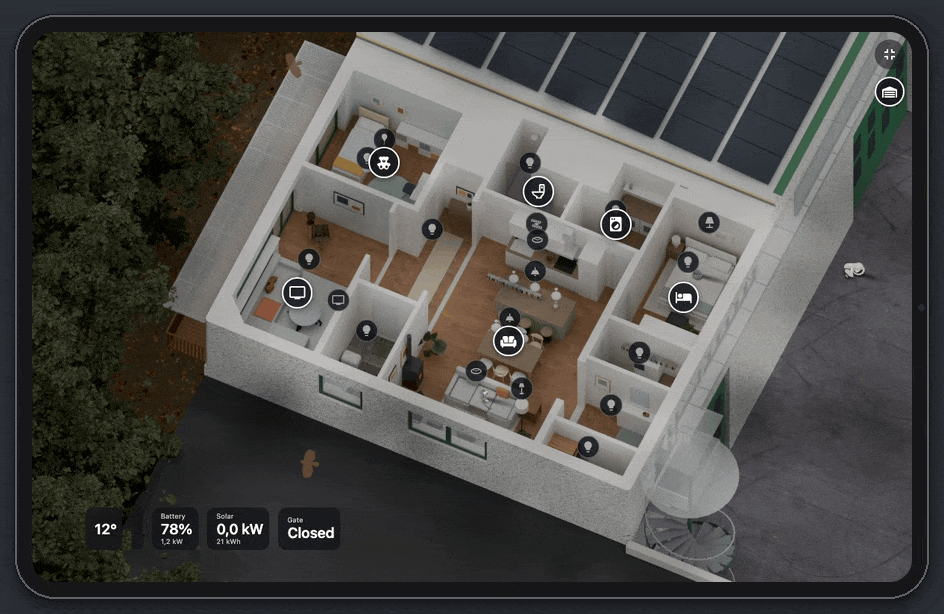
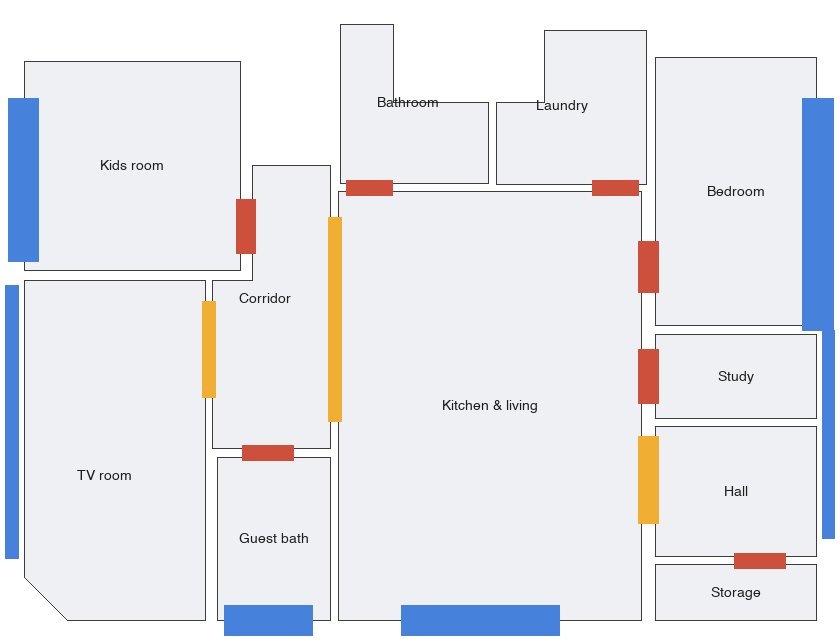
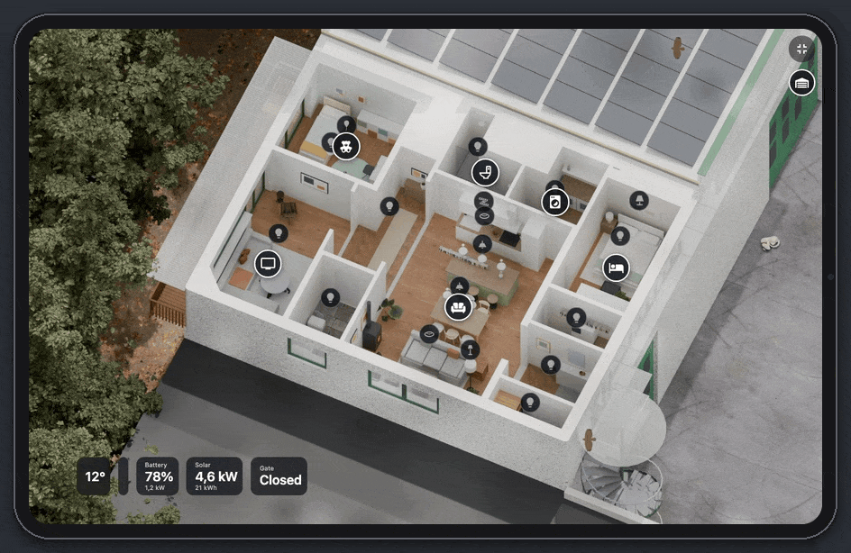
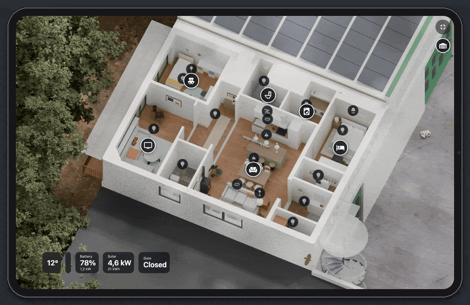
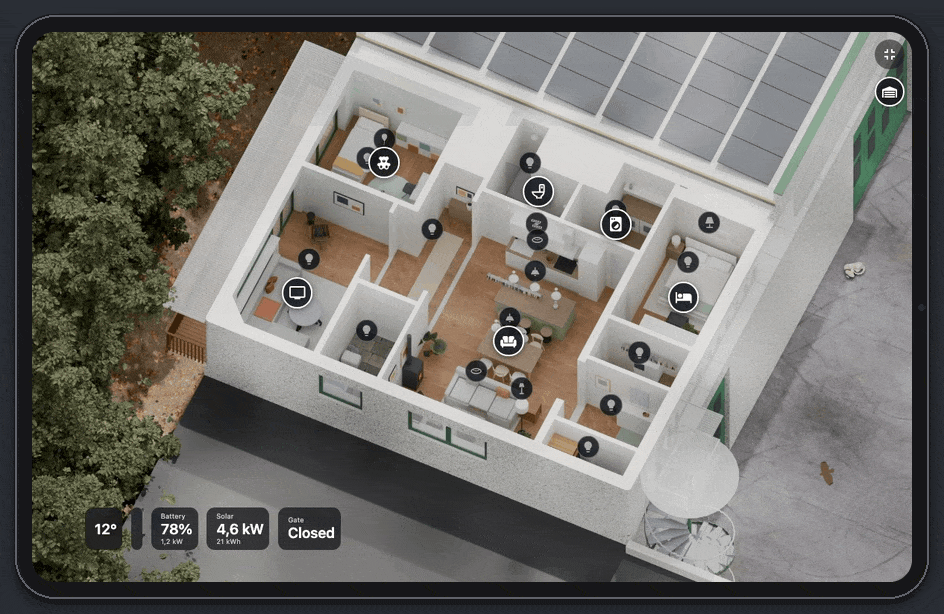
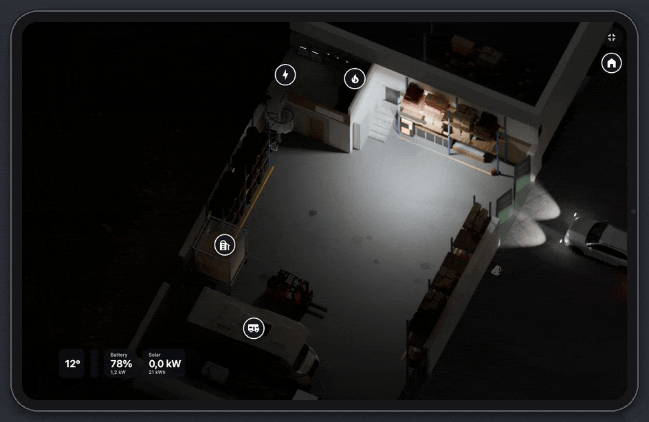

# Home Diorama

**Casa vostra, viva, in Home Assistant.** [🇬🇧 English](README.md) · 🇮🇹 Italiano



È una dashboard che mostra la casa vista dall'alto, disegnata come il plastico di un architetto. E si muove insieme a lei:

- il sole è quello vero, nella posizione giusta per l'ora;
- le luci si accendono nella stanza dove sono davvero;
- se fuori piove, piove anche sul plastico;
- le tapparelle scendono e le porte si aprono;
- le auto entrano ed escono dal garage;
- i gatti girano per casa, il robot pulisce la stanza che sta pulendo davvero e la TV prende i colori del film.

Sta appesa al muro su un tablet, in modalità kiosk. Va bene qualsiasi tablet: io uso un iPad Air 4 ed è lì che è stata provata.

Questa guida spiega come è fatta e come farne una per **casa vostra**, un passo alla volta. La casa che vedete è
**inventata**: l'ho costruita per questa guida esattamente come si costruisce una casa vera, così potete seguire
ogni passaggio. Il garage sotto, invece, esiste davvero.

---

## Indice

1. [Il trucco](#1-il-trucco)
2. [Cosa serve](#2-cosa-serve)
3. [Lo schema generale](#3-lo-schema-generale)
4. [Passo per passo](#4-passo-per-passo)
5. [Più piani](#5-più-piani)
6. [Gli effetti: largo alla fantasia](#6-gli-effetti-largo-alla-fantasia)
7. [Il tablet a muro](#7-il-tablet-a-muro)
8. [Privacy](#8-privacy)
9. [Errori che vi risparmio](#9-errori-che-vi-risparmio)
10. [Come parlare con l'AI](#10-come-parlare-con-lai)
11. [Crediti](#crediti)

---

## 1. Il trucco

Niente 3D calcolato al momento: sono tutte **immagini preparate prima**.

Blender disegna la casa una volta sola, sempre dalla stessa inquadratura, con una qualità che nessun tablet
riuscirebbe a reggere dal vivo. Di immagini ne prepara tante: di giorno con il sole in ogni posizione, di notte, una
per ogni luce accesa, una per ogni porta aperta.

La card di Home Assistant guarda lo stato delle entità e mette una sopra l'altra le immagini giuste. Poi ci disegna
sopra quello che si muove: meteo, uccelli, gatti, robot, auto.

Così sembra un film d'animazione, e su un iPad Air del 2020 va a **60 fotogrammi al secondo**.

L'idea viene da [questo post di u/batubatu0 su r/homeassistant](https://www.reddit.com/r/homeassistant/comments/1wzc637/); da lì un
effetto ha tirato l'altro.

---

## 2. Cosa serve

| Cosa | Per fare cosa | Costo | Note |
|---|---|---|---|
| **Home Assistant** | sapere cosa succede in casa: luci, sensori, meteo, chi c'è | — | va bene qualsiasi installazione |
| **Un computer con una buona scheda grafica** | far girare Blender | — | un Mac con chip Apple o un PC con una NVIDIA; tutte le immagini richiedono da una a qualche ora |
| **[Blender](https://www.blender.org)** | costruire la casa e fare le immagini | gratis | lo comandano gli script che scrive l'AI: non serve mai aprirlo |
| **Un'AI che programma** | scrive gli script, costruisce la casa, prepara le immagini, scrive la card | abbonamento | Claude Code, Codex o Gemini CLI |
| **Una pianta della casa** | dare all'AI muri, porte e finestre | — | quella del geometra, un disegno o anche uno schizzo con le misure: basta questo |
| *Facoltativo:* un telefono con LiDAR (iPhone Pro) e *3D Scanner App* | misure più precise senza metro | gratis (esportando in USDZ) | non serve: la pianta basta |
| **Foto di ogni stanza** | arredare il modello com'è casa vostra | — | da più angolazioni, con le luci accese e spente |
| **Modelli e texture di [Poly Haven](https://polyhaven.com)** | pavimenti, legno, piante, oggetti | gratis (CC0) | niente roba a pagamento: quello che manca, Blender lo costruisce con forme semplici |
| **Auto, camper e muletto da [Sketchfab](https://sketchfab.com/search?features=downloadable&type=models)** | i mezzi nel garage | gratis (CC) | cercate il vostro modello con il filtro *Downloadable* e una licenza Creative Commons, scaricatelo in glTF (`.glb`); l'AI lo ridipinge con i colori della vostra auto. Con licenza CC BY va citato l'autore (vedi [Crediti](#crediti)) |
| **La card** (JavaScript in HA) | sovrappone le immagini e disegna quello che si muove | — | non è pubblicata: questa guida è la ricetta con cui la vostra AI scrive la vostra |
| **Un tablet, app di HA e [kiosk-mode](https://github.com/NemesisRE/kiosk-mode)** (da HACS) | il pannello a muro | — | va bene qualsiasi tablet decente; io uso un iPad Air 4 ed è testata lì |

**A voi tocca** fare le foto, rispondere alle domande dell'AI ("la porta del bagno si apre verso destra o verso
sinistra?") e soprattutto **guardare le immagini** e dire cosa non va. Modello, script e codice sono lavoro dell'AI.

---

## 3. Lo schema generale

```
 FOTO E MISURE            LA CASA IN UN FILE        BLENDER (di notte, sul vostro computer)   HOME ASSISTANT
 ─────────────            ──────────────────        ───────────────────────────────────────   ──────────────
 pianta o schizzo  ─┐     layout.json:              sempre la stessa inquadratura              /config/www/…
 (scansione LiDAR)  ├──►  stanze, muri,      ──►    ├─ giorno, ~90 posizioni del sole   ──►     immagini e json
 foto delle stanze ─┘     porte, finestre,          ├─ notte                                          │
                          mobili, luci              ├─ un'immagine per ogni luce                      ▼
                                                    ├─ porte aperte, tapparelle giù             la card legge gli
                                                    ├─ profondità (per nascondere i gatti)      stati di HA, sceglie
                                                    └─ mappe: pavimento, icone, percorsi        le immagini e anima
                                                                                                il resto
                                                                                                       │
                                                                                                       ▼
                                                                                             iPad a muro, in kiosk
```

---

## 4. Passo per passo

### 1. La casa in un file

Si parte da **un semplice file di testo**, `layout.json`, che descrive la casa:

- le stanze, cioè il loro contorno in centimetri;
- lo spessore dei muri;
- porte e finestre: dove sono, quanto sono larghe, da che parte si aprono;
- i mobili;
- le luci, divise per gruppi.

Non serve nessuno strumento speciale: basta dare all'AI una pianta o un disegno con i muri. Le strade sono tre:

| Da dove | Come | Precisione |
|---|---|---|
| **Pianta o disegno con i muri** (PDF, DWG, immagine, file di un programma di disegno) | la si passa all'AI, che la trasforma in `layout.json` | ottima: i muri della casa vera sono venuti da un disegno così |
| **Schizzo a mano con le misure** | una foto dello schizzo, al resto pensa l'AI | sufficiente per cominciare |
| *Facoltativo:* **scansione LiDAR** (3D Scanner App, export USDZ) | si gira per casa col telefono; uno script taglia la scansione all'altezza giusta e trova i muri | 2 cm circa, utile dove non c'è una pianta (il garage della casa vera) |

Per la casa di esempio la pianta è stata inventata dentro i muri esterni di un edificio vero, così il garage sotto e
il cortile intorno combaciano ancora:



> 💡 **Per controllare:** dopo ogni modifica fatevi mostrare dall'AI **un'immagine della pianta**, non il file. Gli
> errori saltano subito all'occhio: una porta montata al contrario, un muro troppo sottile.

### 2. Arredare partendo dalle foto

Stanza per stanza, date le foto all'AI. Lei costruisce i mobili con forme semplici (scatole, cilindri, lastre) con
misure e colori giusti, poi riveste tutto con texture e oggetti di Poly Haven.

Per la casa di esempio la richiesta era *"come un catalogo IKEA"*: mobili bianchi, rovere chiaro, tessuti grigi, un
tocco di verde salvia, terracotta e senape, e tante piante.

Si procede a giri:

1. l'AI prepara un'anteprima veloce;
2. voi dite cosa non torna ("il piano sporge di 40 cm verso sud, così ci si siede");
3. lei corregge e si ricomincia.

Le cose che fanno davvero la differenza:

- **le luci al posto giusto**: ogni faretto, lampada e striscia LED, con le foto da accese per capirne il colore;
- **i vetri trasparenti** delle finestre;
- **lo schermo della TV che si illumina**, che servirà poi per HyperHDR.

### 3. L'inquadratura

**Una sola inquadratura, che non si cambia più.** Tutte le immagini devono combaciare al pixel: una volta decisa, non
si tocca.

| Impostazione | Casa di esempio | Perché |
|---|---|---|
| Vista | dall'alto, inclinata di 30° e ruotata di 25° | si vedono i muri tagliati e un po' di prospettiva |
| Muri | tagliati a mezza altezza | così si vede dentro le stanze |
| Risoluzione | da 1600 × 1200 a 1920 × 1200 | di più l'iPad va in crisi con la memoria |
| Motore | Cycles, su scheda grafica | luce realistica e ombre morbide |
| Intorno | anche l'esterno: cortile, bosco, pannelli solari sul tetto | un plastico vero, non una casa sospesa nel vuoto |

### 4. Le immagini

È la parte lunga, ma la fa il computer di notte.

| Immagine | Quante | Cosa ne fa la card |
|---|---|---|
| `giorno` | 1 | la base |
| `sole_<azimut>_<elevazione>` | una novantina (una ogni 15°) | sfuma le due più vicine alla posizione vera del sole (`sun.sun`) |
| `notte` | 1 | la casa al buio, con la sola luce della luna |
| `<luce>.jpg` | una per gruppo di luci | si somma all'immagine quando quella luce è accesa, con il colore e l'intensità della lampadina vera |
| porte e finestre `porte/<nome>/f1…fN` | qualche fotogramma per apertura | l'animazione quando il sensore si apre o si chiude |
| tapparelle | una per tapparella | scendono seguendo la posizione della `cover` e scuriscono la stanza |
| auto | i fotogrammi del percorso | entrano ed escono quando la persona arriva o se ne va |
| `profondita.png` | 1 | gatti e cane spariscono dietro i mobili |
| mappe json (`pavimento`, `icone`, `aperture`, percorsi) | — | dove cadono pavimento, icone e porte nell'immagine, e dove possono camminare robot e gatti |

> ⚠️ **Un render alla volta.** Due Blender insieme sulla stessa scheda grafica possono perdere un'immagine senza
> nessun messaggio di errore. Ve ne accorgete solo quando nella card manca un pezzo.

### 5. In Home Assistant

1. Copiate le immagini in `/config/www/home-3d/` e la card in `/config/www/home-3d/home-3d-card.js`.
2. Aggiungete la risorsa Lovelace `/local/home-3d/home-3d-card.js?v=1`. **Ogni volta che cambiate la card,
   aumentate il numero dopo `?v=`**, altrimenti il tablet continua a usare quella vecchia.
3. Configurate la card. Questo è il minimo:

```yaml
type: custom:home-3d-card
path: /local/home-3d/
sun: sun.sun
weather: weather.home
lights:                      # gruppo di luci nell'immagine → entità di HA
  living_spots: light.soggiorno
  floor_lamp: light.lampada
  led_tv: light.striscia_tv
openings:                    # porte, finestre, tapparelle
  Front door: { contact: binary_sensor.porta_ingresso }
  Bedroom window: { cover: cover.camera, room: Bedroom }
icons:
  panel:                     # tocchi la stanza e si apre il suo pannello
    Living:
      lights: [living_spots, floor_lamp]
      extra:
        - { title: Stufa a pellet }
        - { entity: binary_sensor.stufa_accesa, name: Stato }
        - { entity: sensor.stufa_potenza, name: Potenza }
```

> 💡 Tenete la configurazione della card in un file a parte (`_home3d.yaml`) e includetelo con `!include` sia nella
> dashboard normale sia in quella dell'iPad: così la cambiate in un posto solo.

### 6. Icone e pannelli

Sulla pianta ci sono due tipi di icone:

- **le luci**: tonde, piene quando sono accese. Un tocco le accende o le spegne.
- **le stanze**: un cerchio bianco. Un tocco apre il pannello della stanza, con luci, clima, tapparelle,
  elettrodomestici e musica.



Le cose delicate chiedono conferma (la serratura vuole due tocchi), oppure sono **solo da guardare**, apposta: la
stufa a pellet, per esempio, dal tablet si vede ma non si comanda.

Zoom e spostamento funzionano come su una mappa: due dita per ingrandire, doppio tocco, trascinare.



---

## 5. Più piani

L'edificio di esempio è su due livelli: sopra **l'appartamento**, sotto **il garage**, con auto, camper, caldaia a
pellet, silo, batteria e inverter.



Ci sono due strade.

### Strada A: `floors:` dentro la card (la più semplice)

Una card sola, con un pulsante per piano in alto. Ogni piano ha la sua cartella di immagini e le sue luci. Le
impostazioni in comune (meteo, sole, icone) si scrivono una volta; se un piano ne ha una sua, vale quella del piano.

```yaml
type: custom:home-3d-card
sun: sun.sun
weather: weather.home
floors:
  - name: Terra
    path: /local/home-3d/terra/
    lights: { garage: light.garage, cantina: light.cantina }
  - name: Primo
    path: /local/home-3d/primo/
    lights: { cucina: light.cucina, soggiorno: light.soggiorno }
```

### Strada B: una vista per piano

**Una vista di Lovelace per ogni piano**, ognuna con la sua card, e sulla card un pulsante rotondo che porta all'altro
piano (sull'iPad in kiosk le schede in alto non ci sono, per questo serve il pulsante):

```yaml
# vista "Casa"
go: { path: garage, icon: garage-variant }
# vista "Garage"
go: { path: casa, icon: home-variant }
```

Così ogni piano ha la sua configurazione completa: il garage ha il neon che sfarfalla, il silo, il camper con gli
allarmi e il cane che corre fuori.

### L'unica regola: **la stessa inquadratura**

Fate tutti i piani con **la stessa inquadratura**: stessa inclinazione e stessa rotazione, solo spostata più in basso
e un po' più larga. Quando si cambia piano l'edificio resta fermo e cambia solo il piano tagliato. Usate anche le
stesse coordinate in centimetri per tutti i piani, cambiando solo l'altezza (qui il garage sta a −600 cm).



---

## 6. Gli effetti: largo alla fantasia

Qui di regole non ce ne sono. **Se vi viene in mente, si può fare**, che ci sia un'entità in HA oppure no. Ogni
effetto qui sotto è nato da un "e se…?".

| Effetto | Cosa lo fa partire | Come funziona | |
|---|---|---|---|
| ☀️ **Il sole vero** | `sun.sun` (azimut ed elevazione) | sfuma le due immagini del sole più vicine; durante il giorno le ombre girano nelle stanze | [GIF](gif/day.gif) |
| 🌧️ **Il meteo** | `weather.*` | nuvole trasparenti, pioggia con gli schizzi, neve, nebbia, raffiche e fulmini, disegnati al momento; il tetto resta asciutto | [GIF](gif/weather.gif) |
| 🦅 **Le poiane** | sole alto e cielo sereno | girano in tondo sulle correnti calde, che il vento sposta piano; poi planano fuori dall'inquadratura e rientrano da un altro lato, si inclinano in curva e ogni tanto battono le ali | [GIF](gif/buzzards.gif) |
| 🐦 **Le rondini** | il mese (da aprile a settembre) | d'estate passano a stormi nel cielo | [GIF](gif/swallows.gif) |
| 🦇 **I pipistrelli** | la notte | escono da sotto una finestra e cacciano intorno a casa | |
| 🐈 **I gatti** | nessuna entità: fanno da soli | modelli di Blender con il mantello vero, 16 direzioni e per ognuno il suo passo, trotto e galoppo; camminano su una mappa della casa, saltano sui mobili e spariscono dietro gli oggetti; se accendete una luce vanno a curiosare | [GIF](gif/cats.gif) |
| 🔥 **Il gatto alla stufa** | stufa a pellet accesa | la luce della fiamma tremola sul pavimento come un fuoco vero, e un gatto va a sdraiarsi lì davanti | [GIF](gif/stove.gif) |
| 🐕 **Il cane** | `weather.*` | corre fuori dal garage; quando piove rientra al riparo e riesce quando ha smesso | [GIF](gif/garage_rain.gif) |
| 🤖 **Il robot aspirapolvere** | `vacuum.*` e la stanza in cui si trova | gira davvero nella stanza che sta pulendo, intorno ai mobili; toccandolo si apre il suo pannello | [GIF](gif/robot.gif) |
| 📺 **La TV con HyperHDR** | il websocket di HyperHDR | lo schermo sulla pianta prende in diretta i colori del film, e la striscia LED dietro si accende con loro | [GIF](gif/tv.gif) |
| 🌈 **Le luci WLED** | il websocket di WLED | il palloncino in cameretta ha sulla pianta gli stessi colori ed effetti di quello vero | [GIF](gif/balloon.gif) |
| 🧺 **Lavatrice e asciugatrice** | i sensori di consumo | il cestello si illumina mentre lavora; l'asciugatrice lampeggia finché qualcuno non la svuota | |
| 🚗 **Le auto** | `device_tracker` e `person` | ognuno ha la sua: esce dal garage con i fari accesi e torna al suo posto | [GIF](gif/garage.gif) |
| 🚪 **Porte e finestre** | i sensori di apertura | si aprono anche nell'immagine | |
| 🪟 **Le tapparelle** | `cover.*` | scendono e scuriscono la stanza, anche di giorno | |
| 💡 **Le luci** | `light.*` | ogni luce illumina la sua stanza, con il suo colore | [GIF](gif/day.gif) |
| 🍃 **Le foglie** | la velocità del vento | il bosco intorno a casa si muove con il vento | |
| 💨 **L'aria** | clima, ventilatore, purificatore | particelle che escono dagli apparecchi nella direzione giusta | |
| 🏭 **Il neon del garage** | il tramonto | si accende la sera e ogni tanto sfarfalla, come i neon vecchi | [GIF](gif/garage.gif) |
| 🛢️ **Silo e batteria** | i sensori di livello | il silo del pellet e la batteria si riempiono e si svuotano nel disegno | |
| 📊 **I riquadri in basso** | meteo, batteria, fotovoltaico, cancello | una fila di riquadri sopra la pianta | |

### Tocca a voi: idee che nessuno ha ancora fatto

- 🎄 a dicembre l'albero di Natale con le lucine, e il gatto che ci gioca;
- 📦 il pacco davanti alla porta quando passa il corriere;
- 🚿 il vapore che esce dalla doccia mentre il boiler scalda;
- ⚡ linee luminose che portano l'energia dai pannelli alla batteria e alla casa;
- 🐟 l'acquario con i pesci che nuotano;
- 🎵 le note che escono dalla cassa quando suona la musica;
- 🌙 la luna vera, con la sua fase;
- 🏊 la piscina che si increspa con il vento.

> **Il ragionamento è sempre lo stesso.** Prima chiedetevi cosa lo fa partire: un'entità, il meteo, l'ora o il caso.
> Poi se conviene prepararlo come immagine (porte, auto, luci) oppure disegnarlo al momento (meteo, uccelli, gatti).
> Il codice lo scrive l'AI.

---

## 7. Il tablet a muro

Qualsiasi tablet va bene. Io uso un iPad Air 4 (2020) con l'app di Home Assistant: è lì che la card è stata
provata e misurata, quindi quando più sotto leggete "iPad" vale per il vostro tablet.

| Cosa | Come |
|---|---|
| **Un utente apposta** | in HA un utente solo per il tablet, senza diritti di amministratore; l'iPad entra con quello |
| **La dashboard di partenza** | solo la pianta, in una vista `panel` a tutto schermo |
| **Il kiosk** | [kiosk-mode](https://github.com/NemesisRE/kiosk-mode) da HACS, attivo **solo** per quell'utente: niente barra in alto e niente menu laterale |
| **L'app** | Home Assistant Companion; consiglio: *Accesso guidato* di iOS, così nessuno esce dall'app |
| **Lo schermo** | sempre acceso, attaccato al caricatore; consiglio: luminosità automatica |
| **La card** | a tutto schermo riempie l'iPad e taglia un po' i bordi; riquadri e icone restano nella parte visibile |

```yaml
# dashboard dell'iPad
kiosk_mode:
  user_settings:
    - users: [ipad-muro]
      kiosk: true
views:
  - title: Pianta
    path: pianta
    type: panel
    cards:
      - !include _home3d.yaml
```

### Perché va liscia su un tablet di cinque anni

- **La memoria.** Quando le immagini caricate occupano troppa memoria, iOS ricarica la pagina. Le immagini che non
  servono vanno tolte davvero dalla pagina, non basta nasconderle: così una casa è passata da 2 GB a 150 MB.
- **Gli aggiornamenti di HA.** Home Assistant manda decine di aggiornamenti al secondo. Ridisegnate solo quando cambia
  un'entità che la card usa davvero: solo questo ha eliminato tutti gli scatti.
- **Tele piccole per gli animali.** Ridisegnare a ogni fotogramma un'area grande come lo schermo costringe l'iPad a
  rispedirla tutta alla scheda grafica: 15 fps. Con un riquadro piccolo per ogni animale, spostato con il CSS, si
  torna a 60.
- **Niente `shadowBlur`** sulle animazioni.

---

## 8. Privacy

La pianta di una casa, insieme a nome, indirizzo e abitudini, è una mappa per chiunque. Per questo:

- **Tutto resta in casa.** Foto, scansioni, immagini e modelli stanno sui vostri computer, e le immagini le prepara il
  vostro computer, senza servizi online.
- **I nomi delle entità** dicono chi vive in casa e dove dorme: teneteli fuori dai repo pubblici.
- **Token di HA e password** non vanno mai nei file della card né in un repo.
- **I comandi delicati** dal tablet chiedono conferma, oppure non ci sono proprio.
- **Le GIF di questa guida** mostrano un appartamento inventato, con **dati inventati**.

---

## 9. Errori che vi risparmio

| Problema | Soluzione |
|---|---|
| Il tablet mostra la card vecchia | aumentate il `?v=` della risorsa Lovelace a ogni modifica |
| Una dashboard in YAML non si aggiorna dopo una modifica | forzate il ricaricamento (`lovelace/config` con `force: true`) o riavviate il browser |
| Manca un'immagine del sole, senza nessun errore | mai due render insieme sulla stessa scheda grafica |
| Di notte le auto hanno un bordo scuro | una maschera sola per tutta l'auto, non una per livello |
| Il gatto passa attraverso i mobili | ci vuole un'immagine di profondità, e il gatto va tagliato dove ha qualcosa davanti |
| La luce di una stanza finisce in quella accanto | ogni luce va preparata con il soffitto invisibile all'inquadratura ma non alla luce |
| La previsione dà pioggia con il sole | per il tempo di *adesso* usate una stazione meteo vicina, non la previsione |
| Sull'iPad le animazioni scattano | misurate i fotogrammi sul tablet vero, non sul computer: sono due mondi diversi |

---

## 10. Come parlare con l'AI

Datele **istruzioni precise** e fatevi **mostrare immagini**, non codice.

**Per cominciare:**

> Voglio una piantina illustrata di casa mia per Home Assistant, come un plastico visto dall'alto, fatta con Blender
> senza interfaccia sul mio computer. Ti do la pianta e le foto di ogni stanza. Per prima cosa scrivi un
> `layout.json` con stanze, muri, porte, finestre, mobili e gruppi di luci, e fammi vedere un'immagine della pianta
> per controllarla. Non caricare mai foto o dati su servizi esterni.

**Per un effetto nuovo:**

> Nella card home-3d voglio [effetto]. Deve partire con [entità o condizione]. Dimmi se conviene prepararlo come
> immagine o disegnarlo al momento su un canvas, poi fallo. Deve restare a 60 fps su un iPad Air 4: un canvas piccolo
> spostato con il CSS e niente `shadowBlur`.

**Per un piano nuovo:**

> Aggiungi il piano [nome]. Usa la stessa inquadratura della casa, spostata su quel piano, con le stesse coordinate e
> un'altezza di −X cm. Poi aggiungilo alla card come vista separata, con il pulsante `go:` per passare da un piano
> all'altro.

## Crediti

I mezzi nel garage sono modelli gratuiti di Sketchfab, ridipinti in Blender:

- ["2022 Audi Q5 S-Line"](https://sketchfab.com/3d-models/940956e2845e43878a112b2903ee3329) di **tonielpro520**, CC BY 4.0
- ["2022 Seat Arona"](https://sketchfab.com/3d-models/340ea656a5784a3988bf26911bb58715) di **BloxBloger**, CC BY-NC 4.0
- ["renault_twingo_gt"](https://sketchfab.com/3d-models/91f48fd2417b4c538d392e4ff50c9542) di **saidiishaq4**, CC BY 4.0
- ["Fiat Ducato Camper"](https://sketchfab.com/3d-models/e42db0f16f36494bae0e2dc549155bab) di **niev**, CC BY 4.0
- ["Forklift"](https://sketchfab.com/3d-models/73d21c990e634589b0c130777751be28) di **mohammad6511**, CC BY 4.0

Pavimenti, legno, piante e oggetti vengono da [Poly Haven](https://polyhaven.com) (CC0).

---

*Fatta da Daniel con tanta pazienza, un Mac mini e Claude Code.*
