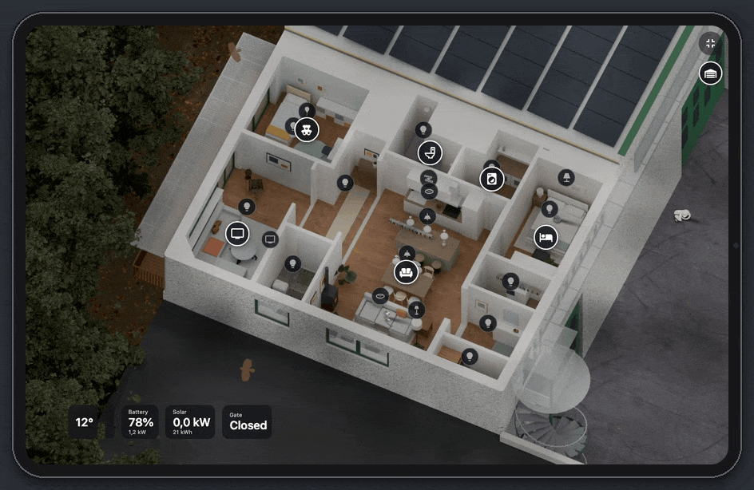
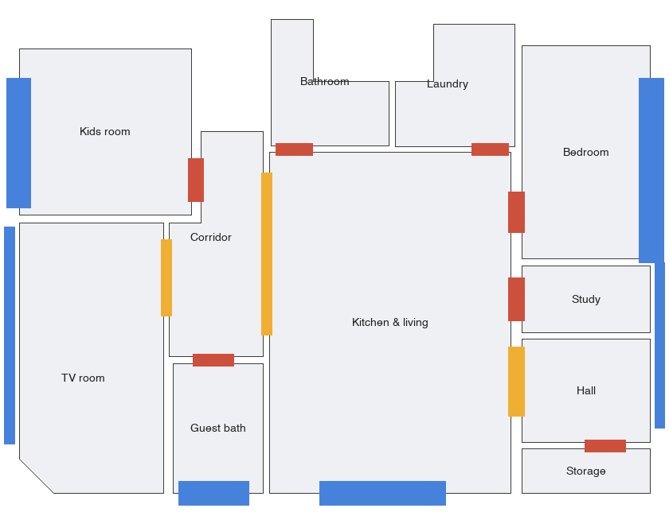
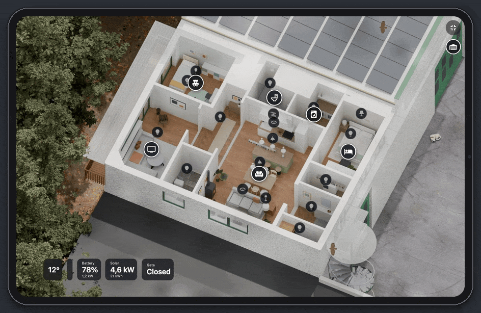
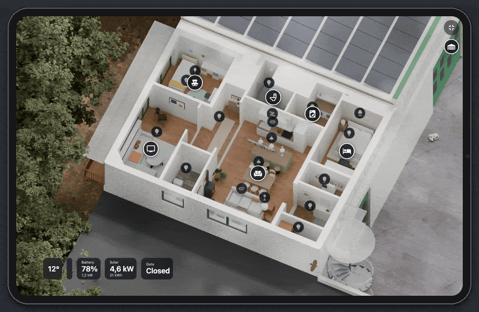
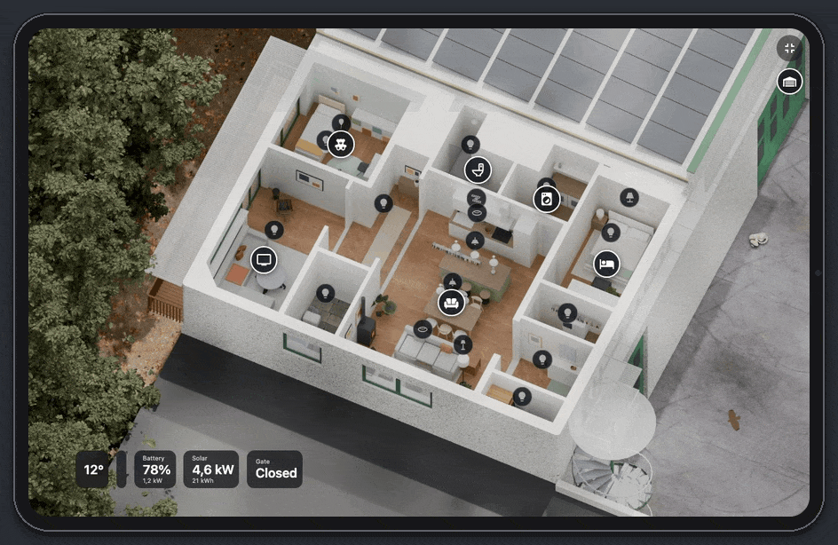
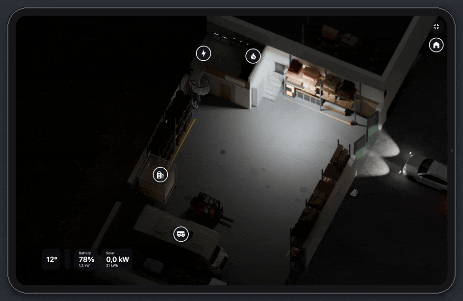

# Home Diorama

**Your house, alive, in Home Assistant.** 🇬🇧 English · [🇮🇹 Italiano](README.it.md)



A dashboard that shows your home from above, drawn like an architect's scale model, and that lives along with it:

- the sun is the real one, where it really is at this hour;
- each light glows in the room where it really is;
- when it rains outside, it rains on the model;
- shutters come down and doors open;
- cars drive in and out of the garage;
- the cats wander around, the robot vacuum cleans the room it is really cleaning, the TV glows with the colours of the film.

It hangs on the wall on a tablet, in kiosk mode. Any tablet will do: I use an iPad Air 4, and that's where it's tested.

This guide shows how it is made and how to make one for **your** home, step by step. The house you see here is
**made up**: it was built for this guide exactly the way a real one is built, so you can follow along. The garage
under it is a real one.

---

## Contents

1. [The trick](#1-the-trick)
2. [What you need](#2-what-you-need)
3. [The big picture](#3-the-big-picture)
4. [Step by step](#4-step-by-step)
5. [More than one floor](#5-more-than-one-floor)
6. [Effects: let your imagination run](#6-effects-let-your-imagination-run)
7. [The tablet on the wall](#7-the-tablet-on-the-wall)
8. [Privacy](#8-privacy)
9. [Mistakes you can skip](#9-mistakes-you-can-skip)
10. [Talking to your AI](#10-talking-to-your-ai)

---

## 1. The trick

No real-time 3D: everything is **pictures made in advance**.

Blender draws the house once, always from the same camera, at a quality no tablet could ever compute live. It makes
lots of pictures: by day with the sun in every position, by night, one for every light, one for every open door.

The card in Home Assistant looks at the state of your entities and stacks the right pictures. On top it draws what
moves: weather, birds, cats, the robot, cars.

So it looks like an animated film, and on a 2020 iPad Air it runs at **60 frames per second**.

The idea comes from [this post by u/batubatu0 on r/homeassistant](https://www.reddit.com/r/homeassistant/comments/1wzc637/); from
there, one effect led to another.

---

## 2. What you need

| What | For | Cost | Notes |
|---|---|---|---|
| **Home Assistant** | knowing what happens at home: lights, sensors, weather, who is in | — | any installation |
| **A computer with a good graphics card** | running Blender | — | a Mac with Apple silicon or a PC with an NVIDIA card; a full set of pictures takes one to a few hours |
| **[Blender](https://www.blender.org)** | building the house and rendering it | free | driven by scripts the AI writes; you never need to open it |
| **An AI coding agent** | writes the scripts, builds the house, renders it, writes the card | subscription | Claude Code, Codex or Gemini CLI |
| **A floor plan** | giving the AI the walls, doors and windows | — | an architect's plan, a drawing or even a sketch with measurements: that's all it takes |
| *Optional:* a phone with LiDAR (iPhone Pro) and *3D Scanner App* | more precise measurements without a tape | free (USDZ export) | not needed: the plan is enough |
| **Photos of every room** | furnishing the model like your home | — | from several angles, lights on and off |
| **Models and textures from [Poly Haven](https://polyhaven.com)** | floors, wood, plants, objects | free (CC0) | nothing paid: whatever is missing, Blender builds from simple shapes |
| **The card** (JavaScript in HA) | stacks the pictures and draws what moves | — | not published: this guide is the recipe your AI builds yours from |
| **A tablet, the HA app and [kiosk-mode](https://github.com/NemesisRE/kiosk-mode)** (HACS) | the wall panel | — | any decent tablet; I use an iPad Air 4 and it's tested there |

**Your part** is taking the photos, answering the AI's questions ("does the bathroom door open to the left or to the
right?") and above all **looking at the pictures** and saying what is wrong. Modelling, scripts and code are the
AI's job.

---

## 3. The big picture

```
 PHOTOS AND SIZES         THE HOUSE AS A FILE       BLENDER (at night, on your computer)     HOME ASSISTANT
 ────────────────         ───────────────────       ────────────────────────────────────     ──────────────
 plan or sketch    ─┐     layout.json:              always the same camera                    /config/www/…
 (LiDAR scan)       ├──►  rooms, walls,      ──►    ├─ day, ~90 sun positions          ──►     pictures and json
 room photos       ─┘     doors, windows,           ├─ night                                         │
                          furniture, lights         ├─ one picture per light                         ▼
                                                    ├─ open doors, closed shutters             the card reads
                                                    ├─ depth (to hide the cats)                HA's states, picks
                                                    └─ maps: floor, icons, paths               the pictures and
                                                                                               animates the rest
                                                                                                      │
                                                                                                      ▼
                                                                                            iPad on the wall, kiosk
```

---

## 4. Step by step

### 1. The house as a file

Everything starts from **a plain text file**, `layout.json`, that describes the house:

- the rooms, as outlines in centimetres;
- how thick the walls are;
- every door and window: where it is, how wide, which way it opens;
- the furniture;
- the lights, in groups.

No special tool needed: give the AI a plan or a drawing with the walls. Three ways:

| From | How | Accuracy |
|---|---|---|
| **A plan or drawing with the walls** (PDF, DWG, image, a drawing app's file) | give it to the AI, it turns it into `layout.json` | excellent: the real house's walls came from a drawing like this |
| **A hand sketch with measurements** | a photo of the sketch, the AI does the rest | enough to start |
| *Optional:* **LiDAR scan** (3D Scanner App, USDZ export) | walk around with the phone; a script slices the scan at the right height and finds the walls | about 2 cm, handy where there's no plan (the real house's garage) |

For the example house the plan was invented inside the outer walls of a real building, so the garage below and the
yard around it still match:



> 💡 **To check:** after every change ask the AI for **a picture of the plan**, not the file. Mistakes jump out: a
> door on the wrong side, a wall too thin.

### 2. Furnishing from photos

Give the AI the photos, room by room. It builds the furniture from simple shapes (boxes, cylinders, slabs) with the
right sizes and colours, and dresses the scene with Poly Haven's textures and objects.

For the example house the brief was *"like an IKEA catalogue"*: white units, light oak, grey fabrics, a touch of
sage green, terracotta and mustard, and lots of plants.

You go in rounds:

1. the AI renders a quick preview;
2. you say what is off ("the worktop overhangs 40 cm on the south side, so you can sit there");
3. it fixes it, and round again.

What makes the difference:

- **the lights in the right place**: every spotlight, lamp and LED strip, with "lights on" photos for their colour;
- **see-through glass** in the windows;
- **a TV screen that glows**, for HyperHDR later.

### 3. The camera

**One camera, fixed forever.** Every picture has to line up to the pixel: once chosen, it never moves.

| Setting | Example house | Why |
|---|---|---|
| View | from above, tilted 30°, turned 25° | you see the cut walls and a bit of perspective |
| Walls | cut at half height | you see into the rooms |
| Resolution | 1600 × 1200 to 1920 × 1200 | above that the iPad runs out of memory |
| Engine | Cycles, on the GPU | realistic light, soft shadows |
| Around it | the outside too: yard, woods, solar panels on the roof | a real scale model, not a house floating in the void |

### 4. The pictures

The long part, but the computer does it at night.

| Picture | How many | What the card does with it |
|---|---|---|
| `giorno` (day) | 1 | the base |
| `sole_<azimuth>_<elevation>` | about ninety (one every 15°) | blends the two nearest to the real sun of `sun.sun` |
| `notte` (night) | 1 | the house in the dark, moonlight only |
| `<light>.jpg` | one per light group | added on top while that light is on, with the colour and brightness of the real bulb |
| doors and windows `porte/<name>/f1…fN` | a few frames each | the animation when the sensor opens or closes |
| shutters | one each | they come down following the `cover`'s position and darken the room |
| cars | the frames along their path | they drive in and out as the person arrives or leaves |
| `profondita.png` (depth) | 1 | cats and the dog disappear behind the furniture |
| json maps (`pavimento`, `icone`, `aperture`, paths) | — | where floor, icons and doors land in the picture, where the robot and the cats can walk |

> ⚠️ **One render at a time.** Two Blenders on the same graphics card can silently drop a picture. You only notice
> when a piece is missing in the card.

### 5. Into Home Assistant

1. Copy the pictures to `/config/www/home-3d/` and the card to `/config/www/home-3d/home-3d-card.js`.
2. Add the Lovelace resource `/local/home-3d/home-3d-card.js?v=1`. **Every time you change the card, raise the
   number after `?v=`**, or the tablet keeps the old one.
3. Configure the card. The bare minimum:

```yaml
type: custom:home-3d-card
path: /local/home-3d/
sun: sun.sun
weather: weather.home
lights:                      # light group in the pictures → HA entity
  living_spots: light.living
  floor_lamp: light.floor_lamp
  led_tv: light.tv_strip
openings:                    # doors, windows, shutters
  Front door: { contact: binary_sensor.front_door }
  Bedroom window: { cover: cover.bedroom, room: Bedroom }
icons:
  panel:                     # tap a room and its panel opens
    Living:
      lights: [living_spots, floor_lamp]
      extra:
        - { title: Pellet stove }
        - { entity: binary_sensor.stove_on, name: State }
        - { entity: sensor.stove_power, name: Power }
```

> 💡 Keep the card's configuration in its own file (`_home3d.yaml`) and `!include` it both in your normal dashboard
> and in the iPad's: you change it in one place.

### 6. Icons and panels

Two kinds of icons sit on the plan:

- **lights**: round, filled while on. One tap switches them.
- **rooms**: a white ring. One tap opens the room's panel: lights, climate, shutters, appliances, music.



Sensitive things ask twice (the front lock wants two taps) or are **read only** on purpose: the pellet stove, for
example, shows its state but cannot be switched from the tablet.

Zoom and pan work like a map: pinch, double tap, drag.



---

## 5. More than one floor

The example building has two levels: **the flat** upstairs and **the garage** below, with cars, a camper, a pellet
boiler, a silo, the home battery and the inverters.



Two ways to do it.

### Way A: `floors:` in the card (simplest)

One card, with a button per floor at the top. Each floor has its own folder of pictures and its own lights. What
they share (weather, sun, icons) is written once; a floor's own key wins.

```yaml
type: custom:home-3d-card
sun: sun.sun
weather: weather.home
floors:
  - name: Ground
    path: /local/home-3d/ground/
    lights: { garage: light.garage, cellar: light.cellar }
  - name: First
    path: /local/home-3d/first/
    lights: { kitchen: light.kitchen, living: light.living }
```

### Way B: one view per floor

One **Lovelace view per floor**, each with its own card, and a round button on the card that jumps to the other
floor (on a kiosk iPad there are no tabs, so the button is the way):

```yaml
# view "House"
go: { path: garage, icon: garage-variant }
# view "Garage"
go: { path: house, icon: home-variant }
```

Each floor then has its full configuration: the garage has its flickering neon tube, the silo, the camper with its
alarms, and the dog running outside.

### The one rule: **the same camera**

Render every floor with **the same camera**: same tilt, same turn, only framed lower and a bit wider. When you switch
floors the building stays put and only the cut floor changes. Use the same centimetre coordinates for every floor too,
with a different height (here the garage floor is at −600 cm).



---

## 6. Effects: let your imagination run

There are no rules here. **If you can think of it, it can be done**, with or without an entity in HA. Every effect
below started as "what if…?".

| Effect | What drives it | How it works | |
|---|---|---|---|
| ☀️ **The real sun** | `sun.sun` (azimuth, elevation) | blends the two nearest sun pictures; shadows sweep the rooms during the day | [GIF](gif/day.gif) |
| 🌧️ **Weather** | `weather.*` | see-through clouds, rain with splashes, snow, fog, gusts and lightning, drawn live; the roof stays dry | [GIF](gif/weather.gif) |
| 🦅 **Buzzards** | high sun, clear sky | they circle on thermals that drift with the wind, glide out of the picture and come back from another side, bank in the turns and flap now and then | [GIF](gif/buzzards.gif) |
| 🐦 **Swallows** | the month (April to September) | flocks crossing the summer sky | [GIF](gif/swallows.gif) |
| 🦇 **Bats** | night | they leave their roost under a window and hunt around the house | |
| 🐈 **Cats** | nothing: they live on their own | Blender models with real coats, 16 directions, each with its own walk, trot and gallop; they walk on a map of the house, jump onto furniture and vanish behind things; turn a light on and they come to see | [GIF](gif/cats.gif) |
| 🔥 **A cat by the stove** | the pellet stove on | the flame's light flickers on the floor like a real fire, and a cat goes to stretch out in front of it | [GIF](gif/stove.gif) |
| 🐕 **The dog** | `weather.*` | runs outside the garage; when it rains it goes in for shelter and comes back when it is dry | [GIF](gif/garage_rain.gif) |
| 🤖 **The robot vacuum** | `vacuum.*` and its current room | really laps the room it is cleaning, around the furniture; tap it for its panel | [GIF](gif/robot.gif) |
| 📺 **TV with HyperHDR** | HyperHDR's websocket | the screen on the plan shows the film's colours live, and the LED strip behind it glows with them | [GIF](gif/tv.gif) |
| 🌈 **WLED lights** | WLED's websocket | the balloon lamp in the kids' room has on the plan the same colours and effects as the real one | [GIF](gif/balloon.gif) |
| 🧺 **Washer and dryer** | power sensors | the drum glows while it runs; the dryer blinks until someone empties it | |
| 🚗 **Cars** | `device_tracker` / `person` | everyone has their car: it leaves the garage with its headlights on, and comes back to its bay | [GIF](gif/garage.gif) |
| 🚪 **Doors and windows** | contact sensors | they really open in the picture | |
| 🪟 **Shutters** | `cover.*` | they come down and darken the room, by day too | |
| 💡 **Lights** | `light.*` | each light fills its own room, in its own colour | [GIF](gif/day.gif) |
| 🍃 **Leaves** | wind speed | the woods around the house stir with the wind | |
| 💨 **Air** | AC, fan, purifier | particles out of the devices, the right way | |
| 🏭 **The garage neon** | sunset | it comes on in the evening and flickers now and then, like an old tube | [GIF](gif/garage.gif) |
| 🛢️ **Silo and battery** | level sensors | the pellet silo and the battery fill and empty in the drawing | |
| 📊 **The tiles at the bottom** | weather, battery, solar, gate | a row of tiles over the plan | |

### Your turn: ideas nobody has made yet

- 🎄 a Christmas tree with twinkling lights in December (and the cat playing with it);
- 📦 a parcel by the door when the courier rings;
- 🚿 steam out of the shower while the boiler heats;
- ⚡ glowing lines carrying the energy from the panels to the battery and the house;
- 🐟 an aquarium with swimming fish;
- 🎵 notes floating over the speaker that is playing;
- 🌙 the real moon, with its phase;
- 🏊 a pool rippling in the wind.

> **The recipe is always the same.** First ask what drives it: an entity, the weather, the time of day, chance. Then
> whether it is better as pre-rendered pictures (doors, cars, lights) or drawn live (weather, birds, cats). The AI
> writes the code.

---

## 7. The tablet on the wall

Any tablet will do. I use an iPad Air 4 (2020) with the Home Assistant app: that's where the card was tested and
measured, so where you read "iPad" below, think of your tablet.

| What | How |
|---|---|
| **A user of its own** | an HA user just for the tablet, not an administrator; the iPad logs in with it |
| **Its default dashboard** | only the plan, in a `panel` view, full screen |
| **Kiosk** | [kiosk-mode](https://github.com/NemesisRE/kiosk-mode) from HACS, **only** for that user: no header, no sidebar |
| **The app** | Home Assistant Companion; tip: iOS *Guided Access*, so nobody leaves the app |
| **The screen** | always on, on its charger; tip: auto brightness |
| **The card** | full screen it covers the iPad and trims the edges; tiles and icons stay in the visible part |

```yaml
# the iPad's dashboard
kiosk_mode:
  user_settings:
    - users: [wall-ipad]
      kiosk: true
views:
  - title: Plan
    path: plan
    type: panel
    cards:
      - !include _home3d.yaml
```

### Why it stays smooth on a five-year-old tablet

- **Memory.** When decoded pictures take too much memory, iOS reloads the page. Pictures not in use must leave the
  page, hiding them is not enough. That took one house from 2 GB to 150 MB.
- **HA's updates.** Home Assistant sends dozens of updates a second. Redraw only when an entity the card uses has
  changed: that alone removed every stutter.
- **Small canvases for animals.** Redrawing a screen-sized canvas every frame makes the iPad upload all of it to the
  GPU: 15 fps. One small canvas per animal, moved with CSS: back to 60.
- **No `shadowBlur`** on animated canvases.

---

## 8. Privacy

A floorplan, together with a name, an address and habits, is a map for anyone. So:

- **Everything stays at home.** Photos, scans, pictures and models stay on your own computers, and your computer
  renders them: no online service.
- **Entity ids** tell who lives in the house and where they sleep: keep them out of public repos.
- **HA tokens and passwords** never go into the card's files or a repo.
- **Sensitive commands** from the tablet ask for confirmation, or are not there at all.
- **The GIFs in this guide** show a made-up flat with **made-up states**.

---

## 9. Mistakes you can skip

| Problem | Fix |
|---|---|
| The tablet shows the old card | raise the `?v=` of the Lovelace resource after every change |
| A YAML dashboard does not update after an edit | force a reload (`lovelace/config` with `force: true`) or restart the browser |
| A sun picture is missing, no error anywhere | never two renders at once on the same GPU |
| Cars get a dark rim at night | one mask for the whole car, not one per layer |
| The cat walks through furniture | a depth picture, and the cat cut wherever something stands in front of it |
| A room's light spills into the next | render each light with the ceiling invisible to the camera but not to the light |
| The forecast says rain in the sunshine | for the weather *now* use a nearby station, not the forecast |
| Animations stutter on the iPad | measure frames on the real tablet, not on your computer: two different worlds |

---

## 10. Talking to your AI

Give it **precise instructions** and have it **show you pictures**, not code.

**To start:**

> I want an illustrated floorplan of my home for Home Assistant, like a scale model seen from above, rendered with
> Blender headless on my computer. Here are the plan and photos of every room. First write a `layout.json` with
> rooms, walls, doors, windows, furniture and light groups, and show me a picture of the plan to check it. Never
> upload photos or data to outside services.

**For a new effect:**

> In the home-3d card I want [effect]. It is driven by [entity or condition]. Tell me whether it is better as
> pre-rendered pictures or drawn live on a canvas, then build it. It has to stay at 60 fps on an iPad Air 4: a small
> canvas moved with CSS, no `shadowBlur`.

**For a new floor:**

> Add the floor [name]. Use the same camera as the house, framed on that floor, with the same coordinates at a height
> of −X cm. Then add it to the card as a separate view, with the `go:` button to switch floors.

---

*Made by Daniel with a lot of patience, a Mac mini and Claude Code.*
